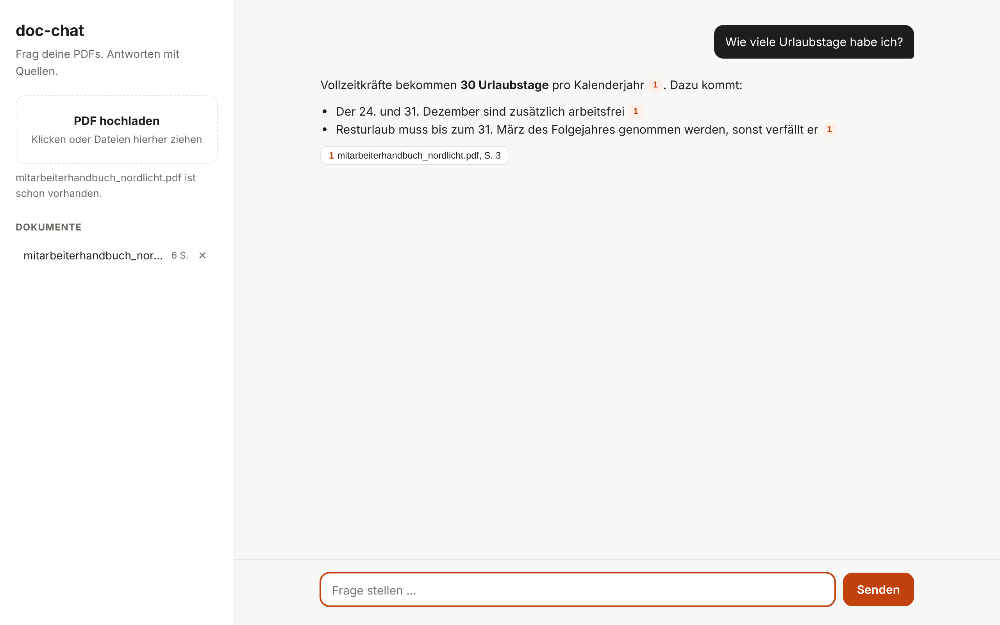

# pdf-chat

Ein kleines Projekt, mit dem man PDFs hochladen und Fragen dazu stellen kann. Die Antworten kommen von Claude, und hinter jeder Aussage steht die Quelle mit Seitenzahl. Wenn man auf die Quelle klickt, sieht man die Textstelle aus dem PDF.



## Wie es funktioniert

1. Text aus dem PDF auslesen (pypdf), Seite für Seite
2. In Chunks von ca. 900 Zeichen aufteilen. Ein Chunk geht nie über eine Seite hinaus, damit die Seitenzahl beim Zitieren stimmt
3. Embeddings mit fastembed berechnen (lokales Modell, kostenlos, kann auch Deutsch) und in ChromaDB speichern
4. Bei einer Frage parallel suchen mit:
   - BM25 (normale Stichwortsuche)
   - Vektorsuche (findet auch Sachen, die anders formuliert sind)
5. Beide Ergebnislisten mit Reciprocal Rank Fusion zusammenführen
6. Die besten 6 Chunks + Frage an Claude schicken, die Antwort wird gestreamt

Problem, auf das ich gestoßen bin: Die normale BM25-Formel (`BM25Okapi`) gibt Wörtern, die in mehr als der Hälfte der Chunks vorkommen, eine IDF von 0 oder sogar negativ. Bei kleinen PDFs mit wenigen Chunks sind dadurch manchmal genau die richtigen Treffer rausgefallen. Ich hab deshalb die IDF-Formel von Lucene genommen, die immer positiv ist (`app/retrieval.py`).

## Projektstruktur

```
app/
  main.py        FastAPI Routen (Upload, Dokumente, Chat)
  pdf_loader.py  Text aus PDF holen
  chunking.py    Text in Chunks aufteilen
  embeddings.py  fastembed + Hash-Embedder für Tests
  store.py       ChromaDB
  retrieval.py   BM25, Vektorsuche, Fusion
  llm.py         Claude API
static/          Frontend (HTML/CSS/JS, kein Framework)
eval/            Testfragen + Evaluation
tests/
```

## Starten

Man braucht Python 3.11+ und einen API Key von https://console.anthropic.com

```bash
python -m venv .venv
source .venv/bin/activate
pip install -e ".[dev]"
cp .env.example .env   # API Key eintragen
uvicorn app.main:app_factory --factory --reload
```

Dann http://localhost:8000 öffnen. Beim ersten Start lädt fastembed das Modell runter (ca. 220 MB), das dauert kurz.

Oder mit Docker:

```bash
docker compose up --build
```

## Evaluation

Ich wollte wissen, ob die Hybrid-Suche wirklich besser ist als nur eine der beiden Suchen. Dafür gibt es in `eval/` ein ausgedachtes Mitarbeiterhandbuch (6 Seiten) und 20 Fragen, bei denen jeweils die richtige Seite hinterlegt ist. Die Fragen sind extra anders formuliert als der Text, z.B. "Phishing-Mail" statt "verdächtige E-Mails".

```bash
python -m eval.run_eval
```

Ergebnis mit `--embedder hash` (einfacher Embedder ohne echtes Modell):

| Modus  | Hit@3 | MRR  |
|--------|-------|------|
| BM25   | 75%   | 0.72 |
| Vektor | 90%   | 0.82 |
| Hybrid | 95%   | 0.87 |

Hit@3 = richtige Seite ist unter den ersten 3 Treffern. MRR = wie weit oben der richtige Treffer im Schnitt ist (1.0 = immer ganz oben).

TODO: Ergebnis mit dem echten fastembed Modell eintragen

## Tests

```bash
pytest
ruff check .
```

Die Tests brauchen keinen API Key, statt Claude wird ein Fake benutzt und statt fastembed der Hash-Embedder.

## Einstellungen (.env)

| Variable | Standard |
|---|---|
| `ANTHROPIC_API_KEY` | |
| `CLAUDE_MODEL` | `claude-opus-5-5` |
| `CLAUDE_EFFORT` | `low` |
| `TOP_K` | `6` |
| `CHUNK_SIZE` | `900` |
| `CHUNK_OVERLAP` | `150` |

## Ideen

- OCR für gescannte PDFs
- Reranking mit einem Cross-Encoder
- Login, damit jeder nur seine eigenen PDFs sieht
